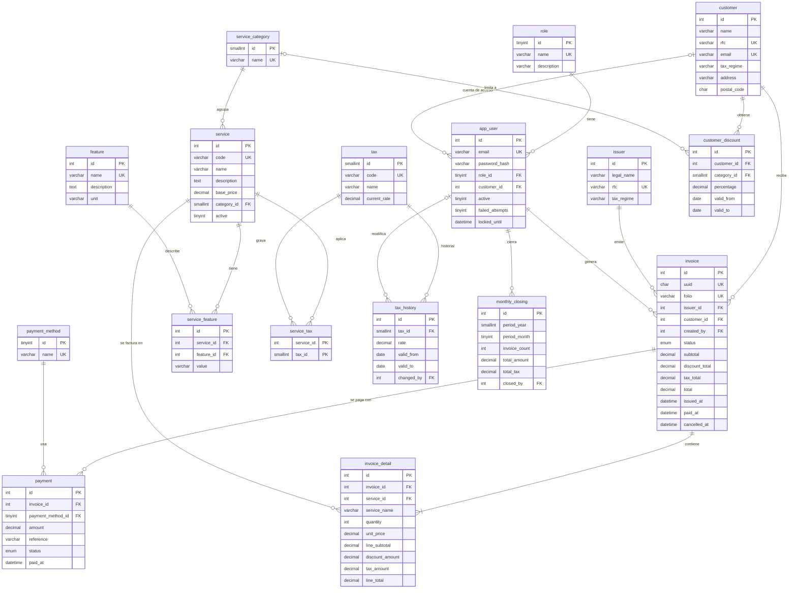

# Diagrama Entidad-Relación (RDS MySQL 8)

17 tablas relacionales. Las 4 tablas de DynamoDB (`audit_log`, `invoice_event`, `user_session`,
`invoice_cart`) no tienen FKs hacia RDS; ver `database/dynamodb/README.md`.

## Cambios respecto al DER original

| Antes | Ahora |
|---|---|
| Tablas en inglés, columnas en español | Todo en inglés (`customer_id`, `paid_at`, `unit_price`) |
| Sin usuarios ni roles | `role` + `app_user` (ADMIN, BILLER, CUSTOMER) |
| Sin impuestos | `tax`, `tax_history`, `service_tax` |
| `invoice` solo con cliente, fecha, total y estado | UUID, folio, emisor, creador, subtotal, descuento, impuestos, total y fechas por estado |
| `service` sin categoría | `service_category` + `code` + `active` |
| `invoice_detail` solo con cantidad y precio | Snapshot de nombre, subtotal, descuento, impuesto y total por línea |
| `payment` sin referencia ni estado | `reference`, `status` y `paid_at` como DATETIME |
| Sin soporte para descuentos ni cierre | `customer_discount`, `monthly_closing` |
| `service_feature` permitía duplicados | `UNIQUE (service_id, feature_id)` |
