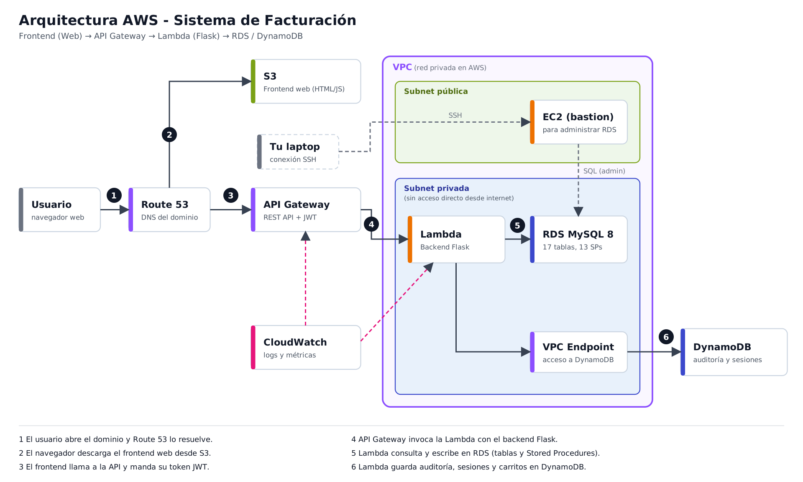

# Arquitectura AWS (versión simple)

Archivos: `arquitectura-aws.png` (para el documento) y `arquitectura-aws.svg` (editable, se abre en el navegador).

Solo se usan servicios que ya vimos en clase: **Route 53, S3, API Gateway, Lambda, VPC (subnet pública y privada), RDS, DynamoDB, EC2, CloudWatch**.

## Cómo fluye una petición

1. El usuario abre el dominio y **Route 53** lo resuelve.
2. El navegador descarga el frontend web desde **S3**.
3. El frontend llama a la API y manda su token JWT a **API Gateway**.
4. API Gateway invoca la **Lambda** que corre el backend Flask.
5. La Lambda lee y escribe en **RDS MySQL** (17 tablas y los Stored Procedures).
6. La Lambda guarda auditoría, sesiones y carritos en **DynamoDB**.
7. **CloudWatch** recibe los logs y métricas de API Gateway y Lambda.

## Qué es la VPC y por qué hay dos subnets

La **VPC** es tu red privada dentro de AWS: todo lo que pones adentro solo se ve entre sí, salvo lo que tú dejes abierto.

| Parte | Qué tiene | Por qué |
|---|---|---|
| Subnet pública | EC2 (bastion) | Es la única que se puede alcanzar desde internet. Sirve para entrar por SSH y correr los scripts SQL en la base. |
| Subnet privada | Lambda y RDS | No tienen acceso directo desde internet. La base de datos nunca queda expuesta: solo la Lambda y el bastion le hablan. |

Así se cubre la parte de **Exposición de Datos Sensibles** del OWASP Top 10: nadie desde fuera puede conectarse al RDS.

## Notas para montarlo

- **RDS pide dos subnets privadas** en zonas de disponibilidad distintas (es requisito del *DB subnet group*). En el dibujo es una sola caja para no complicarlo.
- **VPC Endpoint:** una Lambda dentro de la VPC no llega a DynamoDB por sí sola. Se crea un endpoint de tipo *Gateway* para DynamoDB (no tiene costo).
- **Security Groups:** el del RDS solo permite el puerto 3306 desde el grupo de la Lambda y el del bastion. El del bastion solo permite SSH (22) desde tu IP.
- **Flask en Lambda** necesita un adaptador (por ejemplo `serverless-wsgi` o `apig-wsgi`) para traducir los eventos de API Gateway a peticiones WSGI.
- **Créditos:** el bastion (EC2) y el RDS se pueden **detener** cuando no se usen. DynamoDB está en modo pay-per-request.

## Servicios que no se incluyeron (a propósito)

- **EC2 para Flask, ALB/ELB:** no hacen falta si el backend va en Lambda detrás de API Gateway.
- **SQS y ElastiCache:** se pueden agregar después (SQS para escribir auditoría de forma asíncrona, ElastiCache para cachear el catálogo de servicios), pero ElastiCache cuesta por hora y complica la VPC.
