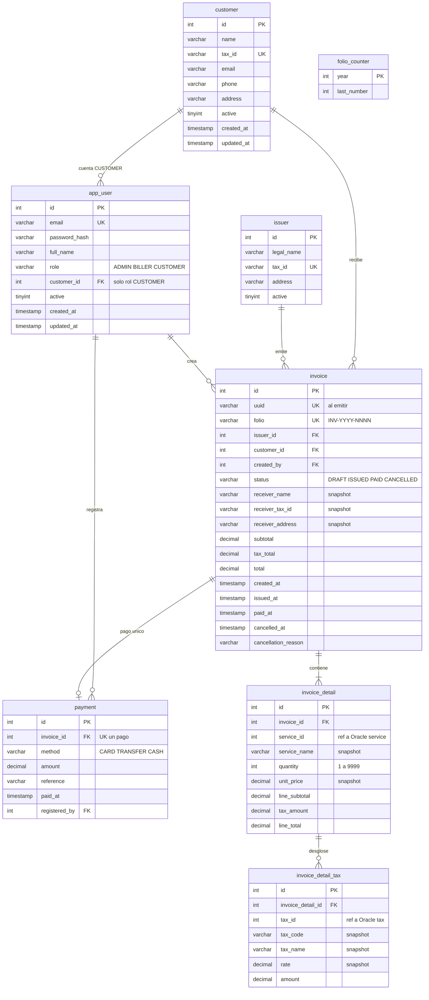

# DER - RDS MySQL (facturacion, 8 tablas)

Modulo de **facturacion** del Sistema de Facturacion en **Amazon RDS for MySQL 8.0**.
Fuente de verdad: `frontend/src/shared/types/domain.ts`. Script: `Bases de datos/RDS(MySQL)/mysql.sql`.

## Notas

- `uuid` y `folio` son nulos en borrador; se asignan al emitir. El folio sale de `folio_counter` (un contador por anio), en la misma transaccion que la factura.
- `invoice_detail.service_id` e `invoice_detail_tax.tax_id` apuntan al catalogo en **Oracle** sin llave foranea (son otra base). El backend los valida; los snapshots hacen que la factura emitida no dependa del catalogo.
- Un pago por factura (`payment.invoice_id` UNIQUE). Un servicio no se repite en una factura.
- Catalogo (servicios, caracteristicas, impuestos): ver [`DER-oracle.md`](DER-oracle.md). Auditoria, sesiones y carrito: ver [`modelo-dynamodb.md`](modelo-dynamodb.md).
