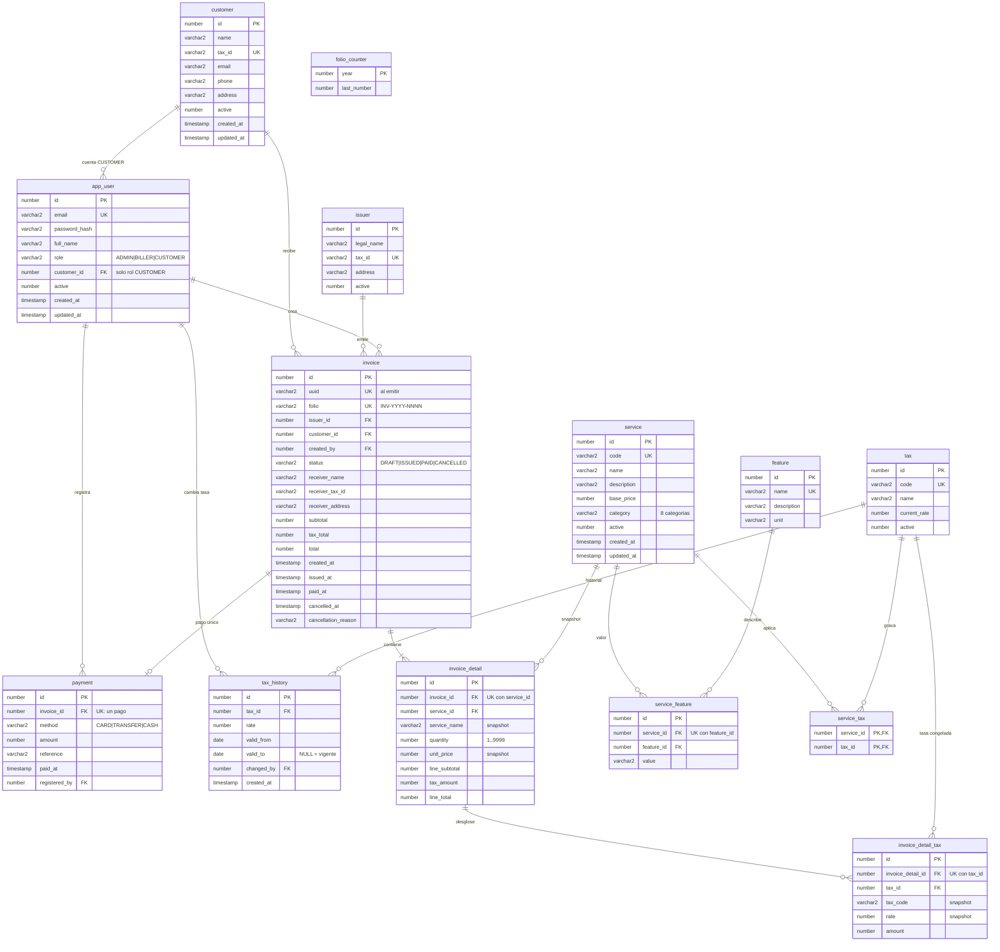

# DER — RDS Oracle

Modelo relacional del Sistema de Facturación para **Amazon RDS for Oracle** (14 tablas).
Fuente de verdad: `frontend/src/shared/types/domain.ts`. Script: `Bases de datos/RDS(Oracle)/oracle.sql`.

## Notas

- `uuid` y `folio` son nulos en borrador; se asignan al emitir. El folio sale de `folio_counter` (un contador por año).
- Snapshots (no cambian si cambia el catálogo): `receiver_*`, `service_name`, `unit_price`, `tax_code`, `rate`.
- Un pago por factura (`payment.invoice_id` UNIQUE). Un servicio no se repite en una factura.
- Un solo periodo de tasa abierto por impuesto (`valid_to` nulo).
- Auditoría, sesiones y carrito no están aquí: van en DynamoDB.
