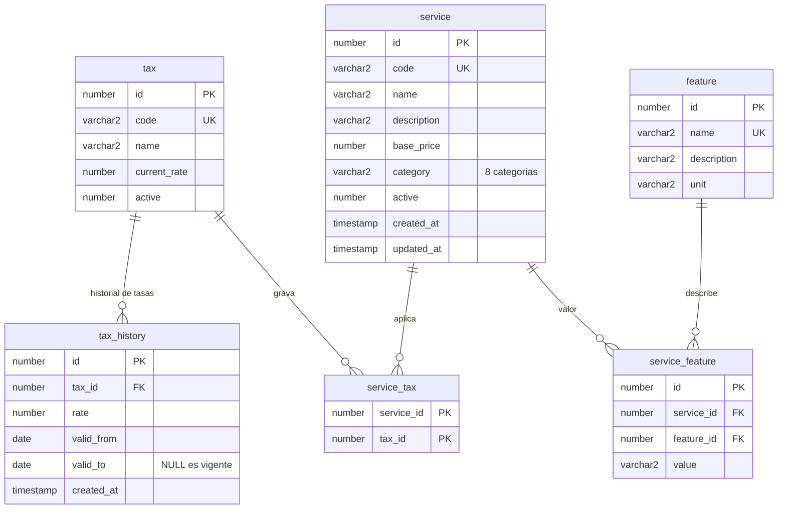

# DER - RDS Oracle (catalogo, 6 tablas)

Modulo de **catalogo** del Sistema de Facturacion en **Amazon RDS for Oracle**.
Fuente de verdad: `frontend/src/shared/types/domain.ts`. Script: `Bases de datos/RDS(Oracle)/oracle.sql`.

## Notas

- Modulo autocontenido: ninguna tabla referencia a MySQL.
- Las facturas (MySQL) apuntan a `service.id` y `tax.id` sin llave foranea y guardan snapshots de nombre, precio, codigo y tasa.
- `tax_history`: vigencia `valid_from <= fecha < valid_to`; `valid_to` nulo es la tasa vigente y solo puede haber una abierta por impuesto.
- `service_feature` es UNIQUE por (`service_id`, `feature_id`). Una caracteristica asignada a un servicio no se puede borrar.
- Facturacion: ver [`DER-mysql.md`](DER-mysql.md). Auditoria, sesiones y carrito: ver [`modelo-dynamodb.md`](modelo-dynamodb.md).
