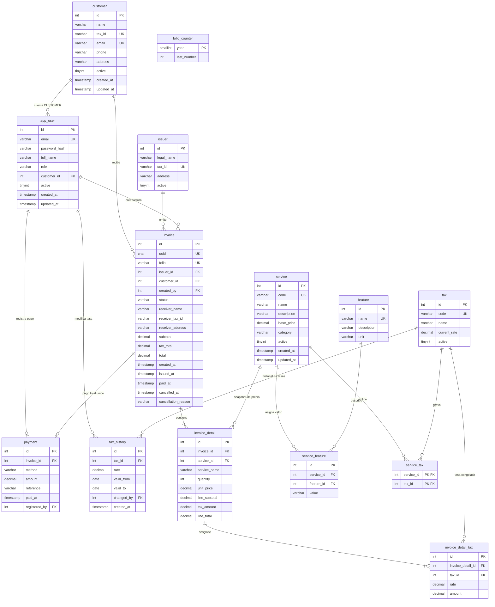

# DER — Sistema de Facturación (modelo relacional, 14 tablas)

Diagrama Entidad-Relación del modelo relacional compartido por **RDS MySQL** y
**RDS Oracle** (mismas tablas, sintaxis nativa en cada carpeta). Fuente de verdad:
`frontend/src/shared/types/domain.ts` y `frontend/docs/DOMAIN.md`.

- Versión renderizada: [`DER-relacional.svg`](DER-relacional.svg) (abrir en el navegador).
- Regenerar: `python generar_diagramas.py`.

## Notas del modelo

| Tema | Detalle |
|---|---|
| `uuid` y `folio` anulables | El frontend solo los asigna al emitir (`DRAFT` → `ISSUED`); folio `INV-YYYY-NNNN` secuencial por año vía `folio_counter`. |
| Snapshots | `receiver_*` en `invoice`, `service_name`/`unit_price` en `invoice_detail` y `rate`/`amount` en `invoice_detail_tax` congelan los valores al emitir; los cambios de catálogo o tasas no alteran facturas emitidas. |
| Un pago por factura | `payment.invoice_id` es UNIQUE (regla del frontend `registerPayment()`). |
| Máx. 1 tasa abierta | La unicidad del periodo abierto (`valid_to IS NULL`) la garantiza la API/SP al cerrar el anterior (ver `04_procedures.sql`). |
| Enums | `role`, `status`, `method` y `category` = `VARCHAR` + `CHECK` (sin CRUD de catálogo en el frontend). |
| Fuera de este DER | Auditoría, sesiones y carrito → DynamoDB (ver [`modelo-dynamodb.md`](modelo-dynamodb.md)). |
