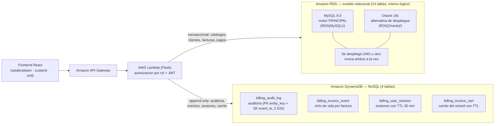

# Arquitectura general — Frontend → AWS (RDS + DynamoDB)

Distribución de datos según la arquitectura declarada del proyecto
(`frontend/README.md`: *API Gateway + Lambda/Flask + RDS MySQL + DynamoDB*).

- Versión renderizada: [`arquitectura-general.svg`](arquitectura-general.svg) (abrir en el navegador).
- Regenerar: `python generar_diagramas.py`.

## Qué vive en cada motor

| Motor | Contenido | Motivo |
|---|---|---|
| **RDS MySQL** (principal) o **RDS Oracle** (alternativa) | `customer`, `app_user`, `issuer`, `tax`, `tax_history`, `service`, `feature`, `service_feature`, `service_tax`, `invoice`, `invoice_detail`, `invoice_detail_tax`, `folio_counter`, `payment` | Datos transaccionales con FKs e integridad (emitir factura = folio + totales + detalle). Uno u otro motor: son instancias separadas sin JOINs posibles |
| **DynamoDB** | `billing_audit_log`, `billing_invoice_event`, `billing_user_session`, `billing_invoice_cart` | Volumen creciente append-only, TTLs y lecturas por clave sin joins; sin FKs hacia RDS |

## Seguridad (resumen)

- RDS en **VPC privada**, sin acceso público; TLS obligatorio; usuario de aplicación con privilegios mínimos.
- Secretos en **AWS Secrets Manager** (nunca en código ni `.env` versionados; ver `.env.example` de cada carpeta).
- DynamoDB con cifrado en servidor; acceso desde la Lambda vía **VPC Endpoint**; permisos IAM mínimos (ver `../DynamoDB/README.md`).
