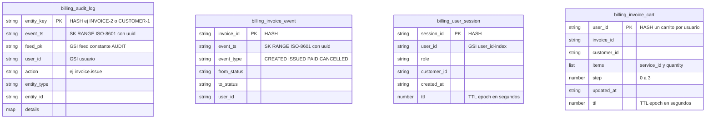

# Modelo - Amazon DynamoDB (4 tablas)

Disenado por patrones de acceso del frontend. Script: `Bases de datos/DynamoDB/dynamodb.sh`.
No replica datos de MySQL ni de Oracle: solo eventos, sesiones y carritos.

## Claves e indices

| Tabla | PK | SK | GSI | TTL |
|---|---|---|---|---|
| `billing_audit_log` | `entity_key` | `event_ts` | `user_id-event_ts-index`, `feed_pk-event_ts-index` | - |
| `billing_invoice_event` | `invoice_id` | `event_ts` | - | - |
| `billing_user_session` | `session_id` | - | `user_id-index` | `ttl` |
| `billing_invoice_cart` | `user_id` | - | - | `ttl` |

## Patron de acceso y operacion

| Operacion del frontend | Tabla | Operacion | Acceso |
|---|---|---|---|
| `writeAudit()` en cada mutacion | audit_log | `PutItem` | - |
| AuditPage (feed descendente) | audit_log | `Query` | GSI `feed_pk`, `ScanIndexForward=false` |
| Historial de una entidad | audit_log | `Query` | PK `entity_key` |
| Actividad de un usuario | audit_log | `Query` | GSI `user_id` |
| Emitir, pagar o cancelar | invoice_event | `PutItem` | - |
| Linea de tiempo de factura | invoice_event | `Query` | PK `invoice_id` |
| Login y validar sesion | user_session | `PutItem` y `GetItem` | PK `session_id` |
| Cerrar sesiones de un usuario | user_session | `Query` y `DeleteItem` | GSI `user_id-index` |
| Guardar, reanudar o borrar wizard | invoice_cart | `PutItem`, `GetItem`, `DeleteItem` | PK `user_id` |

`entity_key` y `event_ts` son cadenas compuestas (por ejemplo `INVOICE#2` y `2026-10-02T10:30:00.000Z#uuid`).
