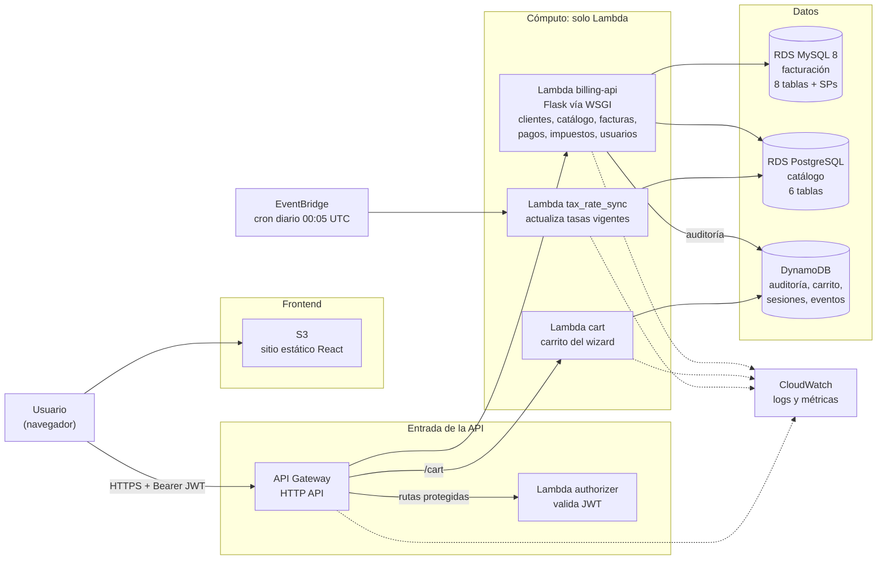

# 1. Arquitectura en AWS (solo Lambda)

## Flujo de una petición

1. El navegador descarga el frontend (React + Vite) desde **S3**.
2. El frontend llama a **API Gateway** con el token JWT en el encabezado `Authorization`.
3. El **Lambda authorizer** valida la firma y la vigencia del token. Si no es válido, responde 401
   sin llegar al backend. `POST /auth/login` no pasa por el authorizer.
4. API Gateway invoca la Lambda correspondiente:
   - `billing-api` (Flask) atiende clientes, catálogo, facturas, pagos, impuestos, usuarios,
     dashboard y auditoría.
   - `cart` atiende `GET/PUT/DELETE /cart` (carrito temporal del asistente de facturación).
5. `billing-api` lee y escribe en **RDS MySQL** (facturación) y **RDS PostgreSQL** (catálogo).
   Cada petición escribe en una sola base, por lo que no hace falta una transacción entre motores.
6. Cada acción que modifica datos se registra en **DynamoDB** (`billing_audit_log`).
7. **EventBridge** ejecuta una vez al día `tax_rate_sync`, que activa las tasas de impuesto
   programadas para esa fecha.
8. **CloudWatch** recibe los logs y métricas de API Gateway y de las tres Lambdas.

## Qué cambia al no usar EC2

| Antes | Ahora |
|---|---|
| EC2 como bastión para correr scripts SQL | Los scripts se ejecutan desde el equipo del desarrollador con un cliente SQL, sobre RDS con acceso público restringido por security group |
| Subred pública y privada para EC2/Lambda/RDS | Sin VPC: la Lambda sale a internet y RDS usa TLS |
| Servidor de aplicación siempre encendido | Cómputo bajo demanda: se paga solo por invocación |

El código de la aplicación no cambia entre ambos esquemas. Mover las Lambdas y RDS a una VPC más
adelante es una decisión de despliegue, no de código.

## Aspectos de seguridad de esta arquitectura

- Las credenciales de base de datos y el `JWT_SECRET` se pasan por variables de entorno de la
  Lambda, nunca en el código fuente.
- El backend rechaza arrancar si `JWT_SECRET` tiene menos de 32 caracteres.
- La conexión a RDS usa TLS (`ssl=require`) cuando el host no es local.
- El rol de ejecución de las Lambdas es `LabRole`, como exige el Learner Lab.
