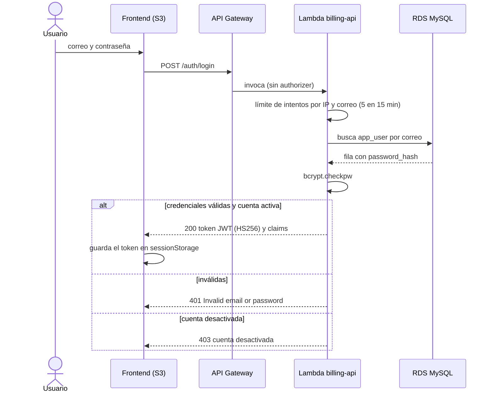
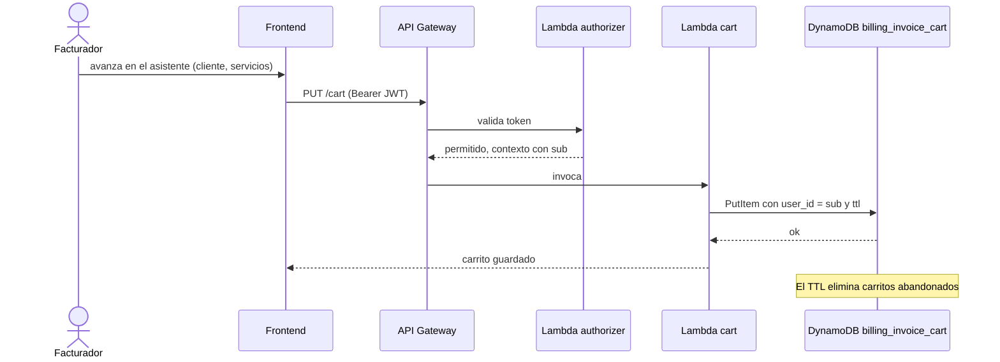
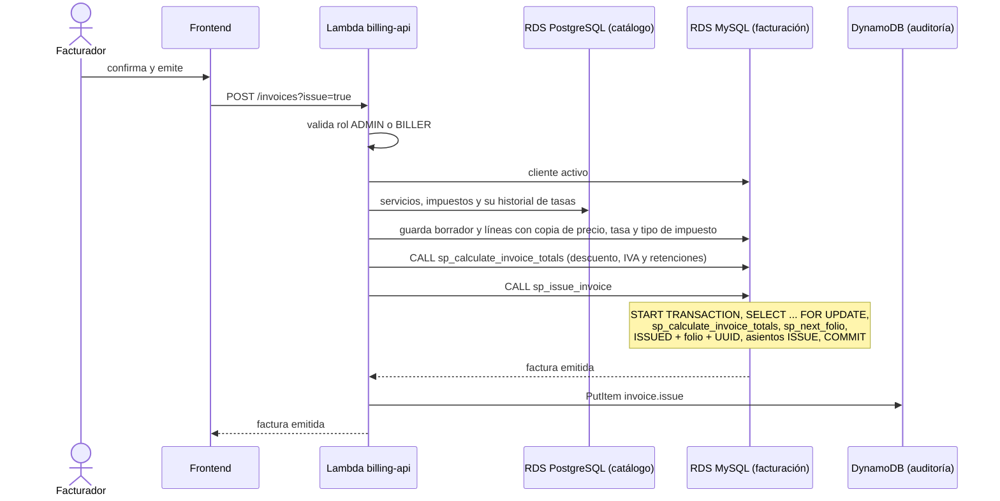
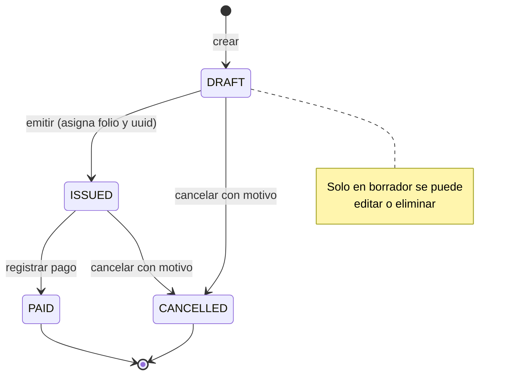
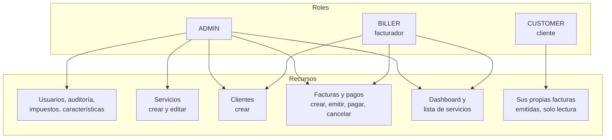

# 2. Flujos, estados y seguridad

## 2.1 Inicio de sesión (JWT)

El token incluye `sub`, `email`, `name`, `role`, `customerId` (solo rol cliente) y `exp`. Dura
30 minutos por defecto (`SESSION_TTL_MS`).

## 2.2 Carrito temporal del asistente de facturación

El `user_id` sale del contexto del authorizer, no del cuerpo de la petición, para que un usuario no
pueda leer ni escribir el carrito de otro.

## 2.3 Emisión de factura

Las líneas de la factura guardan una copia (snapshot) del nombre, precio y tasa de impuesto vigentes.
Una factura emitida no cambia aunque el catálogo se modifique después.

## 2.4 Estados de una factura

`PAID` y `CANCELLED` son estados finales. Una factura admite un solo pago.

## 2.5 Control de acceso por rol (RBAC)

| Recurso | ADMIN | BILLER | CUSTOMER |
|---|:---:|:---:|:---:|
| Usuarios (alta y edición) | Sí | No | No |
| Auditoría | Sí | No | No |
| Impuestos: cambiar tasa | Sí | No | No |
| Características: crear, editar, borrar | Sí | No | No |
| Servicios: crear y editar | Sí | No | No |
| Servicios: consultar | Sí | Sí | No |
| Clientes: consultar y crear | Sí | Sí | No |
| Clientes: editar | Sí | No | No |
| Facturas: crear, editar borrador, emitir, cancelar, eliminar borrador | Sí | Sí | No |
| Pagos: registrar | Sí | Sí | No |
| Facturas: consultar | Todas | Todas | Solo las suyas, y nunca un borrador |
| Dashboard | Sí | Sí | No |

## 2.6 Controles de seguridad (OWASP)

| Riesgo | Control implementado |
|---|---|
| Inyección SQL | Todas las consultas y llamadas a Stored Procedures usan parámetros nombrados (`:nombre`), nunca concatenan valores del usuario |
| Autenticación rota | JWT firmado HS256 con secreto de 32 caracteres o más, expiración, límite de intentos de login |
| Almacenamiento de contraseñas | bcrypt con sal |
| Control de acceso roto | RBAC en cada ruta; el cliente solo ve sus facturas; el `user_id` del carrito sale del token |
| Exposición de datos | TLS hacia RDS; respuestas de error genéricas; sin secretos en el código |
| Configuración insegura | Encabezados `X-Content-Type-Options`, `X-Frame-Options`, `Content-Security-Policy`, `Cache-Control: no-store`; CORS restringible al origen del frontend |
| Datos de entrada | Validación de tipos, largos y caracteres de control; cuerpos mayores a 256 KB se rechazan |
| Condiciones de carrera | `sp_issue_invoice`, `sp_register_payment` y `sp_cancel_invoice` bloquean la factura con `SELECT ... FOR UPDATE` dentro de su transacción; `sp_next_folio` usa `INSERT ... ON DUPLICATE KEY UPDATE` con `LAST_INSERT_ID()` |
| Trazabilidad | Cada alta, cambio, emisión, pago y cancelación se registra en DynamoDB |
