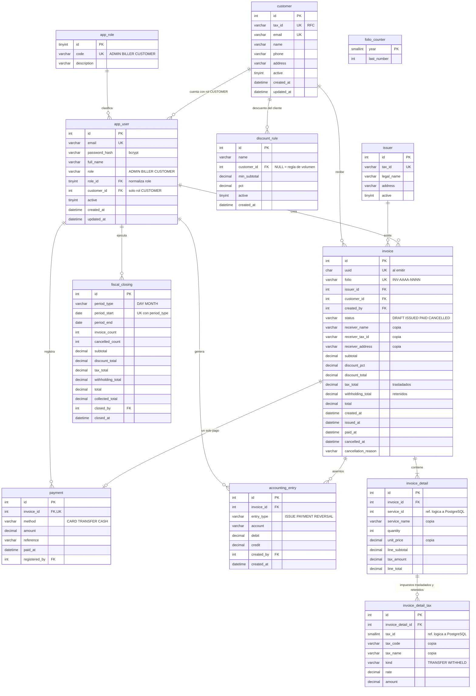

# 3. Modelo relacional — RDS MySQL 8 (facturación)

Base `Facturacion_Mysql` (RDS `db.t4g.micro`, 20 GB gp2, TLS). **12 tablas**: roles, usuarios, clientes,
emisor, facturas, líneas, desglose de impuestos, folios, pagos, reglas de descuento, asientos contables y
cierres fiscales. Scripts: `database/mysql/01_schema.sql` (DDL base), `database/mysql/03_rubrica_ext.sql`
(extensión de la rúbrica) y `database/mysql/05_roles_migration.sql` (migración idempotente de roles para una
base ya existente). Stored Procedures: `database/procedures/mysql_procedures.sql`.

## Reglas de integridad

| Tabla | Restricción | Propósito |
|---|---|---|
| `app_role` | `UNIQUE (code)`, tres filas sembradas: `ADMIN`, `BILLER`, `CUSTOMER` | Catálogo normalizado de roles |
| `app_user.role_id` | `NOT NULL`, FK a `app_role(id)`; los triggers `trg_app_user_bi`/`trg_app_user_bu` lo derivan de `role` | Roles normalizados sin romper la API, que sigue escribiendo `role` |
| `app_user` | `CHECK (role='CUSTOMER' AND customer_id IS NOT NULL) OR (role<>'CUSTOMER' AND customer_id IS NULL)` | Solo los clientes se ligan a un `customer` |
| `invoice` | `CHECK status IN (...)`, `CHECK` motivo obligatorio si `CANCELLED`, importes ≥ 0, `discount_pct` entre 0 y 1 | Máquina de estados y montos válidos |
| `invoice_detail` | `UNIQUE (invoice_id, service_id)`, cantidad 1–9999 | Un servicio por factura |
| `invoice_detail_tax` | `UNIQUE (invoice_detail_id, tax_id)`, `rate` 0–1, `kind IN ('TRANSFER','WITHHELD')` | Desglose sin duplicados |
| `payment` | `UNIQUE (invoice_id)`, `amount > 0`, método en lista | Un pago total por factura |
| `discount_rule` | `pct` 0–0.5, `customer_id` o `min_subtotal` obligatorio | Reglas de descuento válidas |
| `accounting_entry` | `debit ≥ 0`, `credit ≥ 0`, solo uno distinto de cero | Partida doble |
| `fiscal_closing` | `UNIQUE (period_type, period_start)`, `period_end > period_start` | Un cierre por periodo |

## Índices de consulta frecuente

| Índice | Consulta que acelera |
|---|---|
| `invoice (status, issued_at)`, `invoice (status, created_at)` | Listados por estado, dashboard, cierres |
| `invoice (customer_id, status, issued_at)` | Facturas del cliente y antigüedad de saldos |
| `invoice (status, cancelled_at)` | Cancelaciones del periodo en el cierre |
| `accounting_entry (invoice_id, entry_type)` | Reversión contable de una factura |
| `discount_rule (customer_id, active)`, `(active, min_subtotal)` | Búsqueda de la mejor regla de descuento |

## Volumen

40 clientes, ~150 facturas (borradores, emitidas, pagadas y canceladas en 6 meses), ~390 líneas, ~730 asientos
contables y 14 cierres fiscales. Los clientes se siembran con `database/mysql/04_seed_customers.sql`;
las facturas **no son DML versionado**: se generan en ejecución con
`python database/seed/seed_invoices.py` usando los propios Stored Procedures.
