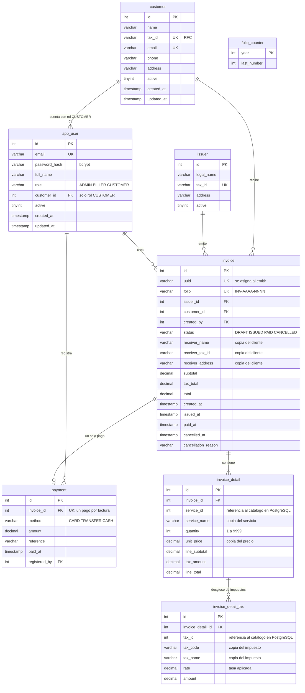

# 3. Modelo relacional — RDS MySQL 8 (facturación)

Base `billing_db`. Contiene usuarios, clientes, emisor, facturas, líneas, desglose de impuestos,
contador de folios y pagos: **8 tablas**. Script: `database/mysql/01_schema.sql`.

## Decisiones de diseño

- **Copias (snapshots) en la factura.** `receiver_*`, `service_name`, `unit_price`, `tax_code`,
  `tax_name` y `rate` se guardan en la propia factura. Una factura emitida es un documento fiscal:
  no debe cambiar si el cliente, el servicio o la tasa se modifican después.
- **Folio atómico.** `folio_counter` guarda un contador por año. Se incrementa dentro de la misma
  transacción que emite la factura, con la fila bloqueada (`FOR UPDATE`), para que dos emisiones
  simultáneas nunca obtengan el mismo folio.
- **Integridad de estados.** `status` solo admite los cuatro valores y las transiciones válidas se
  validan en la aplicación (ver [02-flujos-y-seguridad.md](02-flujos-y-seguridad.md)).
- **Un pago por factura.** `payment.invoice_id` es único.
- **Unicidad.** Correo de usuario, RFC de cliente, folio y uuid de factura son únicos.
- **Referencias entre bases.** `invoice_detail.service_id` e `invoice_detail_tax.tax_id` apuntan al
  catálogo en PostgreSQL. No pueden ser llaves foráneas porque son bases distintas; la aplicación
  las valida antes de guardar (ver [06-interconexion-de-datos.md](06-interconexion-de-datos.md)).
