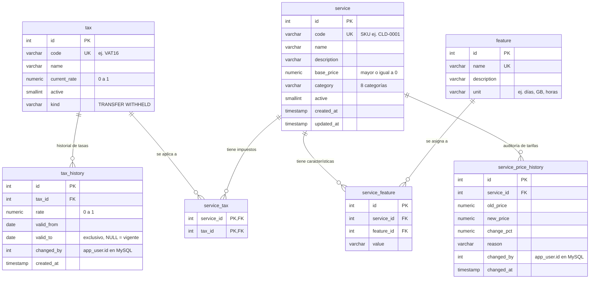

# 4. Modelo relacional — RDS PostgreSQL (catálogo)

Base `postgres` (RDS PostgreSQL 18, `db.t3.micro`, 20 GB gp2, TLS). Contiene impuestos con su historial
de tasas, servicios con su historial de precios, características y las asociaciones entre ellos:
**7 tablas**. Scripts: `database/postgres/01_schema.sql`, `02_compat.sql` y `03_rubrica_ext.sql`.
Stored Procedures: `database/procedures/postgres_procedures.sql`.

## Decisiones de diseño

- **Historial de tasas con vigencia.** Cada tasa vale desde `valid_from` hasta `valid_to`
  (exclusivo). Un índice único parcial garantiza **a lo sumo un periodo abierto por impuesto**
  (`valid_to IS NULL`). Así una factura se calcula con la tasa vigente en su fecha.
- **Tasa actual desnormalizada.** `tax.current_rate` guarda la tasa vigente hoy para consultas
  rápidas. La Lambda `tax_rate_sync` la actualiza cuando llega la fecha de una tasa programada.
- **Relación muchos a muchos con valor.** `service_feature` asocia servicio y característica y
  guarda el valor (por ejemplo, "Soporte" = "24x7"). La pareja `(service_id, feature_id)` es única.
- **Borrado protegido.** Borrar un servicio elimina sus asociaciones (`ON DELETE CASCADE`), pero
  una característica asignada a algún servicio no se puede borrar.
- **Categorías fijas.** `category` se limita con un `CHECK` a ocho valores: Cloud Infrastructure,
  Software Licenses, Support & Maintenance, Consulting, Training, Security, Data & Analytics y
  Development.
- **Índices.** `ix_service_active_name`, `ix_service_feature_feature`, `ix_service_tax_tax` y
  `ix_tax_history_tax_dates` cubren las consultas frecuentes.
- **Impuestos trasladados y retenidos.** `tax.kind` distingue IVA/IEPS (`TRANSFER`, se suman) de
  ISR e IVA retenidos (`WITHHELD`, se restan). Los servicios de Consulting llevan ambas retenciones.
- **Auditoría de tarifas.** El trigger `trg_service_price_audit` registra en `service_price_history`
  cualquier cambio de `base_price` (precio anterior, nuevo, % de cambio, motivo y usuario). El
  procedimiento `sp_update_service_price` fija el usuario y el motivo en la sesión antes de actualizar.
- **Volumen.** 105 servicios en 8 categorías, 50 características y 441 asignaciones servicio-característica
  (`database/postgres/04_seed_catalog.sql`).
