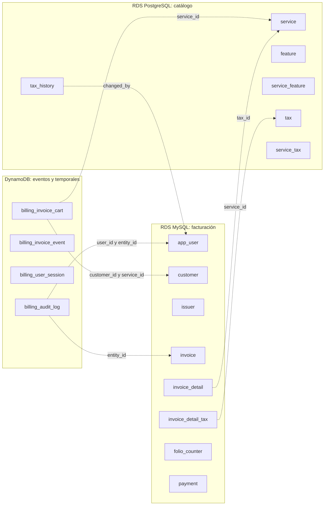

# 6. Interconexión de datos entre MySQL, PostgreSQL y DynamoDB

## 6.1 Reparto de responsabilidades

Las líneas punteadas son referencias lógicas: el identificador se guarda, pero no existe una llave
foránea porque los datos viven en motores distintos.

## 6.2 Referencias entre bases

| Origen | Campo | Destino | Cómo se garantiza la integridad |
|---|---|---|---|
| MySQL `invoice_detail` | `service_id` | PostgreSQL `service.id` | El backend verifica que el servicio exista y esté activo antes de guardar |
| MySQL `invoice_detail_tax` | `tax_id` | PostgreSQL `tax.id` | El backend toma los impuestos del catálogo; además guarda copia de código, nombre y tasa |
| PostgreSQL `tax_history` | `changed_by` | MySQL `app_user.id` | El backend toma el usuario del token JWT |
| DynamoDB `billing_audit_log` | `user_id`, `entity_id` | MySQL `app_user`, `invoice`, `customer` y PostgreSQL `service`, `feature`, `tax` | Al consultar, el backend resuelve etiquetas legibles en la base que corresponde |
| DynamoDB `billing_invoice_cart` | `customer_id`, `items.service_id` | MySQL `customer` y PostgreSQL `service` | Al emitir, el backend vuelve a validar cliente y servicios |

## 6.3 Por qué se separó así

| Dato | Dónde vive | Motivo |
|---|---|---|
| Facturas, pagos, folios, usuarios | MySQL | Requieren transacciones, bloqueo de filas y integridad estricta |
| Servicios, características, impuestos | PostgreSQL | Catálogo de lectura frecuente, con historial de vigencias y restricciones de integridad |
| Auditoría, eventos, carrito, sesiones | DynamoDB | Alto volumen de escrituras, acceso por clave, solo inserción y expiración automática (TTL) |

## 6.4 Consistencia entre bases

- Cada petición modifica **una sola base relacional**, por lo que no se necesita una transacción
  distribuida.
- Las copias (snapshots) en la factura hacen que un documento emitido siga siendo válido aunque el
  catálogo cambie o no esté disponible.
- La auditoría se escribe después del `COMMIT`. Si DynamoDB falla, el evento completo queda en
  CloudWatch Logs para poder reconstruirlo.
